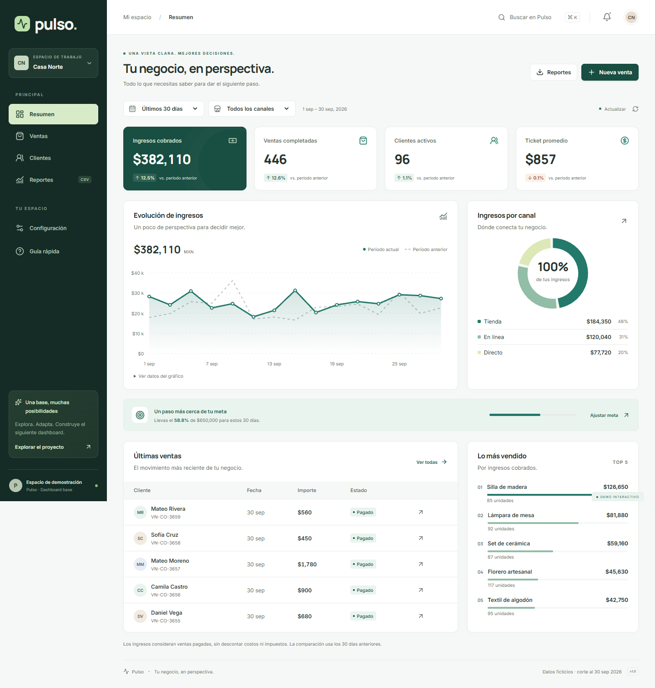

# Pulso · Dashboard base

Una base reutilizable para entender las ventas, los clientes y el desempeño de un negocio. Interfaz en español, datos coherentes, diseño adaptable y una separación clara entre presentación y acceso a datos.

**[Abrir el prototipo](https://ozzy-barbosa.github.io/dashboard-base/)** · **[Estudiar el código](docs/GUIA-DE-ESTUDIO.md)** · **[Prompt maestro ejecutado](docs/PROMPT-MAESTRO.md)**



## Qué incluye

- Resumen: ingresos cobrados, ventas pagadas, clientes activos, ticket promedio, comparación, tendencia, canales, meta y productos destacados.
- Ventas: búsqueda sin acentos, filtros, orden, paginación, detalle, alta, cambios de estado y exportación CSV.
- Clientes: directorio paginado calculado desde las operaciones y acceso al historial filtrado.
- Reportes: resumen ejecutivo, detalle de ventas y resultados por canal descargables.
- Configuración: nombre, meta, tres colores y temas claro, oscuro o del sistema.
- Tres negocios ficticios: comercio, servicios y cafetería. Datos reproducibles con corte al **30 de septiembre de 2026**.
- Estados de carga, vacío y error; navegación por teclado, diálogos accesibles y alternativa tabular para el gráfico.
- Consultas con caché y cancelación; proveedor de datos intercambiable; validación de entradas y respuestas.
- Pruebas de lógica, integración del proveedor, navegador y accesibilidad; publicación automática después de pasar las verificaciones.

## Ejecutar localmente

Necesitas Node.js 24 LTS recomendado (mínimo 22.12) y npm.

```sh
npm ci
npm run dev
```

Abre la dirección que indique Vite y conserva `/dashboard-base/`. La aplicación funciona sin configurar cuentas ni servicios externos.

```sh
npm run check        # Lint + pruebas de lógica + compilación
npx playwright install chromium
npm run test:e2e     # Flujos en escritorio y móvil
npm run format      # Formato consistente
npm run build
npm run preview     # Revisar el resultado compilado
```

## Qué significa “prototipo”

La versión publicada usa exclusivamente datos ficticios. Las altas y cambios se guardan en el navegador y no se comparten entre personas o equipos. El selector de negocio no es un control de permisos. No introduzcas datos personales reales en esta demostración.

El adaptador HTTP y su contrato están preparados para integrar un backend, pero **no hay un backend, autenticación, base de datos ni roles productivos desplegados**. La propuesta de PostgreSQL es un diseño de referencia. Para crecer, el servidor debe filtrar, paginar, agregar y autorizar las consultas; aumentar el dataset local del demo no sustituye esa implementación.

## Estructura

```text
src/
  app/                 # Rutas, filtros compartidos, preferencias y layout
  components/          # Gráficos, diálogos y estados reutilizables
  config/              # Perfiles de negocio y fecha de referencia del demo
  data/                # Contrato, proveedor demo y cliente HTTP
  domain/              # Modelos, validación, cálculos y pruebas
  features/            # Resumen, ventas, clientes, reportes y configuración
  lib/                 # Fechas, formato y CSV
tests/e2e/             # Flujos reales con Playwright y axe
docs/                  # Guía, investigación, contrato API y modelo SQL
.github/workflows/     # Verificación y despliegue en GitHub Pages
```

## Documentación

1. [Guía de estudio e implementación](docs/GUIA-DE-ESTUDIO.md): recorrido de código, ejemplos, adaptación y crecimiento.
2. [Investigación y decisiones](docs/INVESTIGACION.md): fuentes primarias y aplicación al proyecto.
3. [Contrato API](docs/CONTRATO-API.md): operaciones necesarias para reemplazar el proveedor demo.
4. [Modelo PostgreSQL propuesto](docs/schema-reference.sql): entidades, restricciones e índices de referencia.
5. [Verificación](docs/VERIFICACION.md): evidencia, alcance y límites de las pruebas.
6. [Prompt maestro](docs/PROMPT-MAESTRO.md): instrucciones concretas ejecutadas.

## Publicación

El workflow valida cada cambio en `main` y cada pull request. Solo publica desde `main`, después de que pasen las pruebas. Para un fork, habilita Pages con GitHub Actions y ajusta `base` en `vite.config.ts` al nombre del nuevo repositorio. Las rutas hash admiten recarga directa en Pages.

Las fuentes tipográficas se sirven desde el mismo sitio y los datos demo se generan localmente; no hay dependencias visuales de una API externa. Las versiones exactas de npm quedan fijadas por `package-lock.json` y las acciones de CI por SHA.
