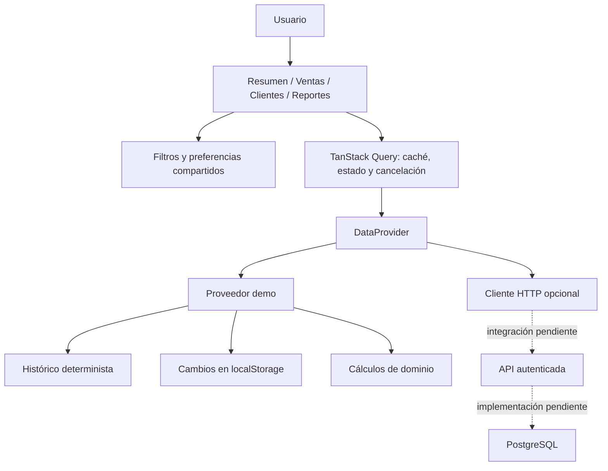
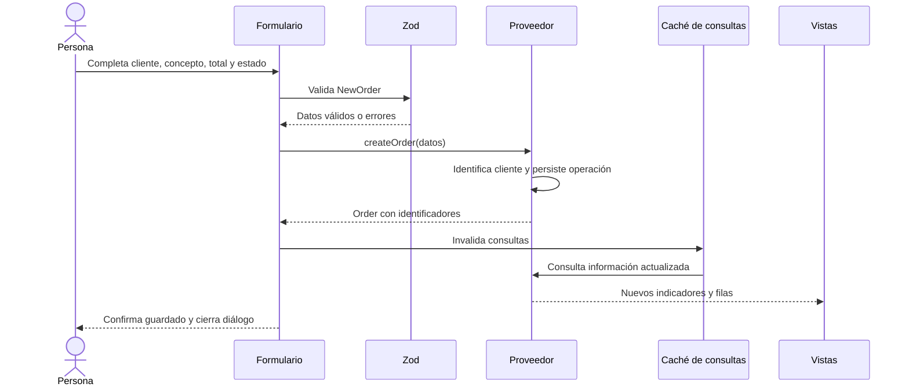
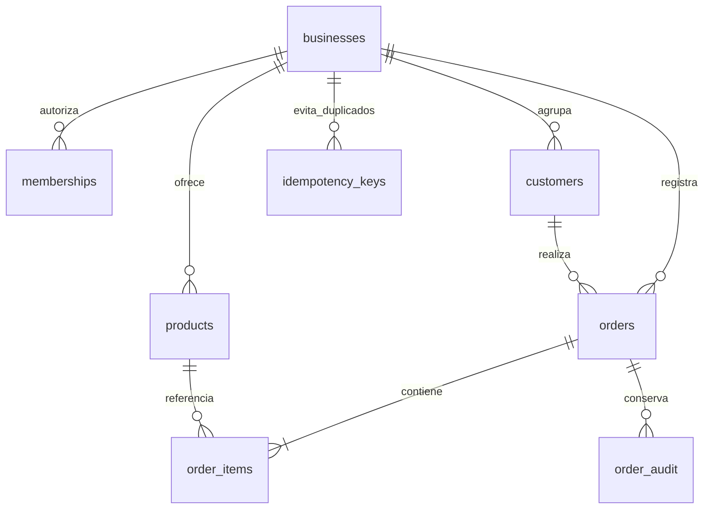

# Pulso: guía de estudio del código e implementación

Versión 1.0 · 1 de octubre de 2026

Esta guía explica la aplicación que existe en este repositorio, cómo seguir el recorrido de una operación y cómo reutilizarla para otro negocio. Se distingue el prototipo funcional de los componentes productivos todavía por implementar.

## 1. Qué construimos

Pulso es una aplicación web con cinco secciones: Resumen, Ventas, Clientes, Reportes y Configuración. Su objetivo es ayudar a entender un negocio, encontrar operaciones y probar cambios sin depender de un backend durante el diseño.

Hay tres perfiles ficticios: Casa Norte, Estudio Sur y Café Bruma. Cada uno tiene un catálogo y un histórico propio. La demostración fija su fecha de corte al **30 de septiembre de 2026** para que las capturas, cálculos y pruebas sean repetibles. “Últimos 30 días” significa septiembre de 2026 en el demo. En modo API, la fecha se calcula en `America/Mazatlan`.

Las nuevas ventas, sus estados y las preferencias se guardan en el navegador. Esto facilita una demostración individual, pero no sirve como base de datos compartida, autorización de usuarios ni respaldo empresarial.

### Lo implementado y lo pendiente

| Capacidad                                               | Estado                                                 |
| ------------------------------------------------------- | ------------------------------------------------------ |
| Pantallas, cálculos, filtros, altas y cambios de estado | Implementado con proveedor demo                        |
| Reportes CSV, preferencias y persistencia local         | Implementado                                           |
| Diseño móvil, claro/oscuro y teclado                    | Implementado y probado en el alcance de verificación   |
| Adaptador HTTP, cancelación y validación de respuestas  | Implementado; pruebas con respuestas simuladas         |
| Publicación de frontend en GitHub Pages                 | Automatizada con GitHub Actions                        |
| API, base de datos, login y roles reales                | No implementados                                       |
| DDL PostgreSQL y estrategia de crecimiento              | Propuesta de referencia; no ejecutada                  |
| Concurrencia, datos privados y operación productiva     | Requieren integración, pruebas y operación adicionales |

## 2. Primer arranque

Usa Node.js 24 LTS recomendado, npm y Git. El mínimo declarado es Node 22.12; las comprobaciones de esta entrega utilizaron Node 24.

```sh
git clone https://github.com/Ozzy-Barbosa/dashboard-base.git
cd dashboard-base
npm ci
npm run dev
```

Visita la dirección de Vite terminada en `/dashboard-base/`. No hace falta crear `.env` para usar el demo.

```sh
npm run check
npx playwright install chromium
npm run test:e2e
```

El primer comando ejecuta análisis estático, pruebas de lógica y construcción. El segundo instala el navegador de prueba, no una dependencia del sitio publicado. El tercero prueba las acciones de usuario en escritorio y móvil. Para revisar la compilación:

```sh
npm run build
npm run preview
```

`vite preview` es una vista local del resultado compilado; no se usa como servidor de producción.

## 3. Mapa del sistema



La regla central es que una pantalla no sabe cómo se almacenan las operaciones. Pide un resumen o una página a `DataProvider`. Reemplazar el proveedor permite mantener gran parte de la UI al conectar otro sistema.

### Carpetas, en el orden recomendado de lectura

| Ruta                                   | Qué estudiar                                                    |
| -------------------------------------- | --------------------------------------------------------------- |
| `src/main.tsx`                         | Montaje de React, router, caché y estilos                       |
| `src/app/context.tsx`                  | Filtros URL, negocio activo, preferencias y consulta de resumen |
| `src/domain/models.ts`                 | Formas de los datos, tipos TypeScript y validación Zod          |
| `src/domain/analytics.ts`              | Reglas de negocio sin dependencia de React                      |
| `src/data/provider.ts`                 | Interfaz que deben cumplir las fuentes de datos                 |
| `src/data/seed.ts`                     | Generación reproducible de datos ficticios                      |
| `src/data/demo.ts`                     | Operaciones locales, persistencia y paginación                  |
| `src/data/http.ts`                     | Cliente de integración, errores, timeout y validación           |
| `src/features/overview/Overview.tsx`   | Cómo un resumen se transforma en una pantalla                   |
| `src/features/orders/Orders.tsx`       | Búsqueda, orden, estado y página de resultados                  |
| `src/features/orders/OrderDialogs.tsx` | Formularios y mutaciones                                        |
| `src/features/customers/Customers.tsx` | Agregación de clientes e historial                              |
| `src/features/reports/Reports.tsx`     | Descargas derivadas del mismo conjunto de filtros               |
| `src/features/settings/Settings.tsx`   | Personalización y restauración del demo                         |
| `src/components/Charts.tsx`            | SVG adaptable y equivalentes tabulares                          |
| `src/components/ui.tsx`                | Diálogo, errores, vacío, carga y estados                        |
| `src/lib/csv.ts`, `src/lib/format.ts`  | Utilidades pequeñas y reutilizables                             |
| `tests/e2e/dashboard.spec.ts`          | Flujos de aceptación en navegador                               |

## 4. Cómo arranca la aplicación

`main.tsx` monta estos proveedores, de fuera hacia dentro:

1. **StrictMode:** ayuda a detectar efectos que no se limpian correctamente en desarrollo.
2. **QueryClientProvider:** comparte caché y políticas de consultas.
3. **HashRouter:** conserva la ruta después de `#`; Pages siempre recibe el archivo principal.
4. **AppProvider:** interpreta filtros, negocio, tema y avisos.
5. **App:** dibuja menú, encabezado, filtros y rutas.

Las cinco pantallas se importan con `lazy`; React las carga cuando se necesitan. `Suspense` muestra un esqueleto durante esa carga. Los gráficos son SVG propios y las fuentes Inter/Manrope se sirven desde el sitio, sin solicitudes a Google Fonts.

Las rutas son `/`, `/ventas`, `/clientes`, `/reportes` y `/configuracion`. Una ruta desconocida vuelve al resumen. Por ejemplo:

```text
https://ozzy-barbosa.github.io/dashboard-base/#/ventas?business=comercio&days=30&channel=Tienda&status=Pendiente
```

La base `/dashboard-base/` corresponde al repositorio; `#/ventas` es la ruta del frontend. Al recargar una URL así, no se necesita que Pages resuelva una carpeta llamada `ventas`.

## 5. Modelo de una venta

La entidad `Order` contiene:

| Campo                                         | Significado                                     |
| --------------------------------------------- | ----------------------------------------------- |
| `id`, `businessId`                            | Identificador de operación y negocio            |
| `customerId`, `customerName`, `customerEmail` | Identidad y presentación del cliente            |
| `product`, `quantity`                         | Concepto y cantidad                             |
| `amountCents`                                 | Total de toda la operación, en centavos enteros |
| `date`                                        | Fecha civil `YYYY-MM-DD`                        |
| `channel`                                     | Tienda, En línea o Directo                      |
| `status`                                      | Pagado, Pendiente o Cancelado                   |

El formulario pide el **total de la venta**, no el precio unitario. No lo multiplica de nuevo por cantidad. La demostración tiene un concepto por operación; una aplicación con carritos debe ampliar el contrato a partidas.

`NewOrder` omite los identificadores generados por el proveedor. Zod valida correo, longitudes, límites, cantidades enteras, importes y fechas civiles reales. TypeScript ayuda durante el desarrollo; Zod vuelve a comprobar los datos que llegan en tiempo de ejecución.

### Por qué centavos enteros

`amountCents: 123456` representa **$1,234.56 MXN**. Las sumas no acumulan pequeños errores de punto flotante. La división entre cien se hace para mostrar o exportar. El ticket promedio se redondea al centavo. Las tarjetas grandes muestran pesos enteros; detalles y CSV conservan centavos.

## 6. Reglas de los indicadores

Todas se concentran en `analytics.ts`.

- **Ingresos cobrados:** suma de `amountCents` de ventas `Pagado`.
- **Ventas completadas:** número de operaciones `Pagado`, no suma de unidades.
- **Clientes activos:** clientes distintos con al menos una venta pagada en el conjunto filtrado.
- **Ticket promedio:** ingresos cobrados / ventas pagadas; cero si no hay ventas.
- **Pendientes:** conteo e importe de operaciones `Pendiente`.
- **Canales:** ingresos y número de ventas pagadas por canal.
- **Top de productos:** cinco conceptos con mayores ingresos pagados; muestra también unidades.
- **Meta:** meta de 30 días multiplicada por `días / 30`. Es una referencia configurable, no una proyección.

El período es inclusivo. Para 1–30 septiembre, la comparación usa 2–31 agosto: ambos tienen 30 días. Cuando la base anterior es cero, la variación muestra “Sin base anterior”. No se inventa un porcentaje de crecimiento.

El gráfico agrupa días en hasta 15 intervalos. El valor de una fila representa el intervalo que empieza en su fecha; el período anterior se alinea por posición. La tabla “Ver datos del gráfico” permite leer cifras exactas. Las sumas de serie y canales se prueban contra el KPI.

Estos ingresos no son utilidad: no descontamos costo, comisiones ni impuestos. Tampoco generamos facturas o contabilidad fiscal.

## 7. Filtros, estado y consultas

Los filtros principales (`business`, `days`, `channel`) viven en la URL y se conservan al navegar. Se aceptan 7, 30 o 90 días. Los valores inválidos vuelven a valores seguros. Ventas añade `q`, `status` y `page`.

El texto de búsqueda mantiene estado local para no perder caracteres durante actualizaciones de URL. La consulta espera 250 ms después de escribir. Las búsquedas normalizan acentos y mayúsculas. El estado visual de búsqueda global fuerza una sesión nueva cuando se llega a Ventas con otro término; no desmonta el campo con cada letra.

Ejemplo real de uso del proveedor desde una consulta:

```tsx
const query = useQuery({
  queryKey: ['orders', options],
  queryFn: async ({ signal }) => (await getProvider()).orders(options, signal),
})
```

`options` incluye filtros, búsqueda, estado, página, tamaño y orden. Cambiar cualquiera produce otra clave. `signal` permite cancelar consultas que ya no se necesitan.

La caché considera fresca una respuesta durante 60 segundos y elimina consultas inactivas después de cinco minutos. Hay un reintento de lectura. Las escrituras no se reintentan automáticamente. El botón Actualizar invalida consultas; una mutación también invalida para recalcular las vistas.

No se usa la página anterior como si fuera resultado del filtro nuevo: durante una consulta distinta, aparece el estado de carga. Esto evita operar sobre filas que ya no corresponden al filtro.

## 8. Recorrido de una nueva venta



En el demo, un correo existente dentro del mismo negocio reutiliza `customerId` y conserva el nombre del cliente. Otro negocio no comparte esa identidad. La venta obtiene un UUID aleatorio.

Cuando se cambia de `Pendiente` a `Pagado`, sus centavos entran en ingresos; al cambiar a `Cancelado`, salen. No existe una llamada a una pasarela de pago. El diálogo lo indica para que el cambio de clasificación no se confunda con un cobro real.

## 9. Persistencia de la demostración

Se usan dos claves versionadas:

```text
pulso.demo.orders.v1
pulso.preferences.v1
```

El histórico original se genera a partir de una semilla fija y no se copia a localStorage. Solo se guardan altas y filas modificadas, hasta 500 cambios. La lectura valida el formato; un almacenamiento corrupto vuelve a la semilla. Una escritura fallida muestra un error y no confirma que guardó.

Configuración permite restaurar los tres negocios, previa confirmación dentro de la interfaz. Esta operación elimina únicamente la clave de cambios demo. No borra preferencias ni datos ajenos del navegador.

Limitaciones: no hay sincronización entre dispositivos, respaldo, transacciones entre pestañas, auditoría persistente ni controles de acceso. Estas funciones corresponden al backend productivo. No usar este almacenamiento para datos sensibles ni como registro definitivo de ventas.

## 10. Exportaciones

`csv.ts` centraliza la serialización:

- UTF-8 con BOM para facilitar la lectura de acentos en Excel.
- Encierra cada celda entre comillas y duplica comillas internas.
- Protege texto que puede interpretarse como fórmula (`=`, `+`, `-`, `@` y ciertos controles iniciales).
- Usa importes decimales con dos posiciones, sin símbolos de moneda, en el detalle de ventas.
- Crea una descarga mediante `Blob` y libera su URL después.

Exportar desde Ventas respeta búsqueda, estado, canal, período y orden; incluye todas las coincidencias, no solo la página visible. Reportes usa período y canal; no hereda la búsqueda de la tabla. El máximo es 10,000 operaciones por descarga. La interfaz y los documentos indican ese alcance.

Los CSV son archivos de datos, no facturas. La protección de fórmulas reduce un riesgo al abrir datos como hoja de cálculo; no reemplaza la validación de origen ni los controles del backend.

## 11. Personalización para otro negocio

### Nivel 1: probar una identidad sin tocar código

1. Elige el tipo de negocio en el menú.
2. Abre Configuración y cambia el nombre y la meta.
3. Selecciona color y tema; guarda.
4. Crea una operación de ejemplo y exporta un reporte.

Las preferencias son locales. Cambiar nombre no cambia el identificador del negocio ni mezcla sus datos.

### Nivel 2: crear otro prototipo desde el código

1. Copia o crea un repositorio a partir de esta base.
2. Ajusta `src/config/businesses.ts`: identidad, catálogo y meta.
3. Si agregas un ID, amplía `businessIds` en `models.ts`; crea una semilla determinista para él.
4. Cambia los canales y estados únicamente después de definir sus reglas de negocio.
5. Ajusta variables CSS e `index.html`; conserva contraste y estados de foco.
6. Cambia los enlaces de documentación y repositorio en las vistas.
7. Ajusta `base` en `vite.config.ts`, ejecuta pruebas y publica el nuevo proyecto.

Ejemplo editable dentro de `businesses.ts`:

```ts
// Estructura de ejemplo; se agrega junto con el ID en el esquema.
const perfil = {
  id: 'comercio',
  name: 'Mi negocio',
  category: 'Comercio local',
  initials: 'MN',
  goalCents: 15_000_000, // $150,000 para 30 días
  products: [{ name: 'Producto de ejemplo', priceCents: 25_000 }],
}
```

Este fragmento ilustra la configuración; no modifica el repositorio por sí solo. El formato exacto está tipado por `BusinessConfig`.

### Nivel 3: integrar datos reales

1. Implementa una API que cumpla [el contrato](CONTRATO-API.md).
2. Añade login y permisos de usuario por negocio. Deriva el negocio autorizado de la sesión, no solo de la URL.
3. Sustituye los IDs demo, catálogo y perfil por configuración autorizada de servidor.
4. Cambia las variables de `.env.local` según `.env.example` y reconstruye.
5. Prueba respuestas válidas, vacías, lentas, canceladas, 401, 403, 429 y 5xx.
6. Prueba acceso cruzado: un usuario de A nunca obtiene ni cambia un recurso de B, aunque cambie la URL o el cuerpo de una petición.
7. Implementa auditoría, respaldo, restauración y observabilidad antes de manejar información empresarial.

El cliente HTTP tiene timeout de 15 s, cookies incluidas y validación Zod. Eso es un punto de integración; no demuestra que un servidor desconocido sea seguro o compatible. El esquema SQL de referencia también necesita migraciones y pruebas propias.

## 12. Cómo prepararlo para muchos datos

La UI renderiza diez ventas o doce clientes por página y como máximo quince puntos del gráfico. Ese límite controla el tamaño visible. En el demo, el proveedor todavía consulta un histórico local pequeño; no hay que llevar ese patrón a millones de filas.

### Etapas de crecimiento

| Etapa                | Implementación sugerida                                                                                               | Medición que decide el siguiente paso                                 |
| -------------------- | --------------------------------------------------------------------------------------------------------------------- | --------------------------------------------------------------------- |
| Prototipo            | Semilla local y cambios acotados                                                                                      | Pruebas de flujos y validación con usuarios                           |
| Primer negocio real  | API única, PostgreSQL, consultas parametrizadas, permisos y paginación remota                                         | Latencia p50/p95, errores, tamaño de respuesta y planes SQL           |
| Más datos y negocios | Índices por negocio/fecha, agregados diarios, búsqueda indexada y exportación asíncrona                               | Consultas lentas, uso de CPU/IO y esperas de conexiones               |
| Cargas mayores       | Cursor para navegación profunda; caché de agregados con invalidación; partición o réplica si la evidencia lo requiere | Pruebas de carga representativas, retraso admisible y costo operativo |

**Paginación:** el contrato actual usa número de página y total. A gran profundidad, evaluar cursor `(fecha, id)` y cambiar contrato/UI; no afirmar que existe ya.

**Agregación:** el servidor devuelve KPI y series pequeños. Para repetir muchas veces consultas históricas, usar una tabla de resúmenes diarios o vista materializada con una estrategia de actualización. Definir qué sucede al cancelar una venta histórica.

**Índices:** empezar por `(business_id, business_date DESC, id DESC)`, historial de cliente y pendientes. Un índice acelera ciertas lecturas y encarece escrituras; comprobar `EXPLAIN (ANALYZE, BUFFERS)` con datos representativos antes de multiplicarlos.

**Búsqueda:** para búsquedas parciales extensas, evaluar trigramas o búsqueda textual, según el idioma y tipo de campo. Escapar comodines y limitar términos. No descargar la tabla entera para filtrar en React.

**Exportación:** el límite síncrono protege memoria y tamaño de respuesta. Una exportación grande debe ejecutarse en servidor, generar un archivo, registrar solicitante y caducar el enlace.

**Caché:** aislar claves por negocio y permisos, además de filtros. Al cerrar sesión, limpiar datos de la persona anterior. La caché actual se separa por negocio; al añadir identidad real, incorporar el alcance de usuario cuando los permisos cambien las respuestas.

**Dinero:** usar enteros o decimales exactos en el backend. Evitar respuestas numéricas que superen `Number.MAX_SAFE_INTEGER`; si se necesitan, migrar a cadenas decimales con validación explícita.

El ensayo automatizado de 100,000 registros comprueba exactitud y tamaño de la página en un proceso local. No prueba concurrencia, dispositivos lentos, redes reales ni capacidad de una base de datos. No permite prometer un número de usuarios o un SLA.

## 13. Modelo relacional de referencia



El [DDL propuesto](schema-reference.sql) utiliza claves compuestas con `business_id` para evitar que una operación referencie por accidente un cliente o producto de otro negocio. Guarda el nombre del producto en la partida para conservar el histórico aunque el catálogo cambie.

La API del prototipo muestra una operación con un concepto. Para una venta con varias partidas, el backend debe entregar una representación resumida o ampliar el contrato y formulario. El total de partidas se debe validar dentro de la misma transacción de guardado.

El modelo propone registro de cambios e idempotencia, pero no implementa automáticamente roles ni RLS. Si se usa RLS, configurarla con un contexto de sesión verificado y un rol de aplicación sin bypass; probarla con conexiones reales. Las migraciones requieren plan de recuperación y respaldo, no solo un script de creación.

## 14. Accesibilidad y experiencia

Hay un enlace “Saltar al contenido”, nombres accesibles para botones de icono, estados de venta con texto, tablas con encabezados y orden anunciado. Los diálogos nativos confinan el foco y admiten Escape; un guardado en curso impide descartar accidentalmente el formulario. La búsqueda global se abre con Ctrl/Cmd+K.

Los gráficos son un apoyo visual. El gráfico de tendencia tiene una tabla de datos y los canales presentan importes y porcentajes en texto. `prefers-reduced-motion` elimina animaciones. Las tablas anchas se desplazan dentro de su contenedor, sin ensanchar la página.

Se corrigieron contraste y etiquetas detectados por axe. La comprobación automática y las pruebas de teclado son parciales: no equivalen a una certificación WCAG ni a pruebas exhaustivas con lectores de pantalla. Antes de entregar a un cliente, recorrer sus datos, rutas y permisos con las tecnologías de asistencia que utilice.

## 15. Pruebas y mantenimiento

| Archivo             | Qué protege                                                                |
| ------------------- | -------------------------------------------------------------------------- |
| `analytics.test.ts` | Dinero, intervalos, comparación, conciliación, aislamiento, búsqueda y CSV |
| `demo.test.ts`      | Alta/cambio de estado, persistencia, identidad, fallos y cancelación       |
| `http.test.ts`      | Configuración, HTTPS, sesión y respuestas inválidas                        |
| `scale.test.ts`     | Exactitud sobre 100,000 operaciones y página acotada                       |
| `dashboard.spec.ts` | Flujos completos y accesibilidad automática en dos tamaños                 |

`npm run check` debe pasar antes de integrar cambios. El workflow repite las pruebas de navegador en Linux. Las dependencias se instalan con `npm ci` y `package-lock.json`; Dependabot propone actualizaciones mensuales, no las integra automáticamente. Revisar cada actualización y ejecutar la misma batería.

Para cambios de esquema local, cambiar versión de la clave y escribir una migración si es importante preservar datos. Para cambios de backend, versionar contrato y despliegues para no romper un frontend todavía cacheado.

## 16. Problemas previsibles y solución

1. **Pantalla en blanco tras publicar un fork.** Revisar `base` y nombre de repositorio; comprobar que `dist` contiene los recursos y que Pages usa Actions.
2. **La venta nueva no aparece.** Verificar fecha, canal, negocio, estado y búsqueda. El demo solo muestra períodos que terminan en su fecha de referencia.
3. **Los ingresos no cambian al crear una venta.** Una venta pendiente o cancelada no suma a ingresos; confirmar el estado y el período.
4. **El navegador no conserva cambios.** El almacenamiento puede estar bloqueado, lleno o borrarse al cerrar una sesión privada. No tratarlo como respaldo.
5. **La API falla aunque responda 200.** Comprobar el contrato Zod, URL base, sesión, CORS, cookies y contenido JSON. Un 200 con forma equivocada sigue siendo un error de integración.

## 17. Preguntas frecuentes

**¿Puedo usarlo ya con datos de un cliente?** Puedes demostrar el flujo con datos ficticios. Antes de usar información real, implementar y probar backend, identidad, permisos y operación.

**¿Cómo cambio colores y logotipo?** Los colores se prueban en Configuración; para identidad permanente, cambia tokens de estilos, el componente de marca y `public/favicon.svg`. Repite contraste y revisión móvil.

**¿Por qué no hay Redux ni una librería de gráficos grande?** El estado compartido es pequeño y las consultas las gestiona TanStack Query. Dos gráficos específicos no justificaban otra dependencia amplia.

**¿Por qué no se añadió una base de datos alojada?** El encargo es una base de prototipos y GitHub Pages. Un backend requiere decisiones por cliente sobre datos, identidad, infraestructura y presupuesto. Aquí se deja el contrato y el modelo para implementarlo de forma controlada.

**¿Qué modifico primero para otro sector?** Definiciones de KPI, entidad principal y estados. Por ejemplo, una clínica necesita citas y disponibilidad; no basta con cambiar “ventas” por “citas” si las reglas son distintas.

## 18. Antes de implementar un negocio real

Definir con su responsable: decisiones que debe facilitar el dashboard, fuente y calidad de datos, reglas exactas de KPI, usuarios y permisos, volumen actual y esperado, zona horaria, moneda, frecuencia de actualización, recuperación y soporte. Crear un piloto con aceptación observable. Medir antes de introducir infraestructura más compleja.

Ver [investigación y fuentes](INVESTIGACION.md), [contrato API](CONTRATO-API.md), [prompt ejecutado](PROMPT-MAESTRO.md) y [evidencia de verificación](VERIFICACION.md).

## Historial

- **1.0.0:** primera base de Pulso, cinco secciones, tres perfiles demo, proveedor intercambiable, pruebas y despliegue en Pages.
- Para cada versión posterior: registrar cambio visible, migración requerida, compatibilidad del contrato y pruebas ejecutadas.
